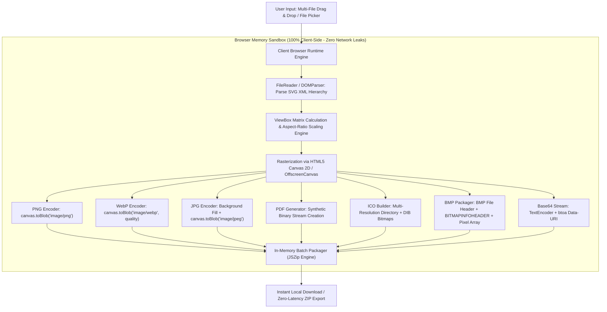

<div align="center">

# ✦ SPManchester SVG Studio

### *Enterprise-Grade, Zero-Latency, 100% Client-Side Vector Graphics Transformation Suite*

[](./LICENSE)
[](https://www.spmanchester.com)
[](#-enterprise-privacy--zero-data-transmission)
[](https://github.com/serviceprovidermanchester/SPManchester-SVG-Studio/actions)
[](./CONTRIBUTING.md)

<p align="center">
  
  
  
  
  
  
</p>

<p align="center">
  <a href="https://serviceprovidermanchester.github.io/SPManchester-SVG-Studio/"><b>🌐 Live Interactive Suite</b></a> •
  <a href="https://www.spmanchester.com"><b>🏢 Official Corporate Portal</b></a> •
  <a href="#-interactive-converter-modules"><b>🛠️ Modules</b></a> •
  <a href="#-architecture--data-flow-pipeline"><b>🏗️ Architecture</b></a> •
  <a href="#-quick-start--local-development"><b>🚀 Quick Start</b></a> •
  <a href="#-about-spmanchester-private-limited"><b>💼 About SPManchester</b></a> •
  <a href="mailto:info@spmanchester.com"><b>✉️ Enterprise Support</b></a>
</p>

---

### ⚡ Built with ❤️ by [SPManchester Private Limited](https://www.spmanchester.com)
**Lead Software Architect:** **Sayed Mudassar Akbar**  
*Corporate Portal:* [www.spmanchester.com](https://www.spmanchester.com) | *Direct Technical Inquiries:* [info@spmanchester.com](mailto:info@spmanchester.com)

---

</div>

## 📌 Executive Overview & The Problem

Modern design, frontend engineering, and content management workflows constantly demand converting vector graphics (`.svg`) into standardized raster bitmaps (`PNG`, `WebP`, `JPG`, `BMP`), multi-resolution desktop icons (`ICO`), vector print deliverables (`PDF`), or inline web streams (`Base64 Data URIs`).

### The Industry Challenge
Traditional online conversion utilities expose organizations to serious architectural and commercial drawbacks:
1. **Critical Data Privacy & IP Exposure**: Proprietary brand marks, unreleased product diagrams, and trade secret wireframes are sent to third-party cloud servers with unknown data retention policies.
2. **Server Bottlenecks & Network Latency**: Cloud-based converters require round-trip network hops, suffer from queue delays during peak traffic, and impose aggressive daily upload caps or subscription paywalls.
3. **Heavy Infrastructure Vulnerabilities**: Backend converter microservices rely on heavyweight dependencies (e.g. ImageMagick, Sharp, Puppeteer headless Chrome, Cairo) that present complex attack surfaces (CVEs) and high monthly cloud compute costs.
4. **Air-Gap Incompatibility**: Traditional tools fail completely in air-gapped corporate intranets, secure defense environments, and offline developer workstations.

### 💡 The SPManchester Solution
**SPManchester SVG Studio** is an open-source, enterprise-grade vector graphics transformation engine built by **SPManchester Private Limited**. It shifts 100% of the computational workload into the visitor's local browser memory utilizing native HTML5 Canvas 2D contexts, the Web Blob API, and in-memory compression pipelines. 

**Result:** Zero network transmission, zero cloud costs, instantaneous conversion speeds, and absolute privacy.

---

## 🛠️ Interactive Converter Modules

The suite provides 7 specialized, production-ready conversion engines accessible through the unified master hub or deployed individually:

| Module | Source Format | Target Format | Key Capabilities | Enterprise Use Case | Live Directory |
| :--- | :---: | :---: | :--- | :--- | :--- |
| **SVG to PNG** | `.svg` | `.png` | High-DPI rasterization, alpha transparency preservation, custom pixel dimensions | UI/UX component assets, design design tokens, marketing banners | [`./svg-to-png/`](./svg-to-png/) |
| **SVG to WebP** | `.svg` | `.webp` | Modern next-gen lossy/lossless compression, complete alpha fidelity, reduced payload | Web performance optimization, Core Web Vitals score elevation | [`./svg-to-webp/`](./svg-to-webp/) |
| **SVG to JPG** | `.svg` | `.jpg` | High-compatibility photo format, adjustable quality slider, customizable background canvas fill | Email newsletters, legacy software compatibility, e-commerce thumbnails | [`./svg-to-jpg/`](./svg-to-jpg/) |
| **SVG to PDF** | `.svg` | `.pdf` | Multi-page print document generation, vector coordinate preservation | Printable specification sheets, invoices, architectural drawings | [`./svg-to-pdf/`](./svg-to-pdf/) |
| **SVG to ICO** | `.svg` | `.ico` | Multi-resolution container generation (16×16, 32×32, 48×48 px) in one binary stream | Website favicons, Windows desktop application icons | [`./svg-to-ico/`](./svg-to-ico/) |
| **SVG to BMP** | `.svg` | `.bmp` | 24-bit / 32-bit uncompressed raster matrix with standard DIB header encoding | Industrial control displays, embedded systems, legacy Windows applications | [`./svg-to-bmp/`](./svg-to-bmp/) |
| **SVG to Base64**| `.svg` | `Data URI` | Direct string encoding to RFC 2397 Data URI format with single-click clipboard copying | Inline CSS backgrounds, zero-HTTP-request HTML embedding | [`./svg-to-base64/`](./svg-to-base64/) |

---

## 🏗️ Architecture & Data Flow Pipeline

The entire system operates inside a client-side execution sandbox. Under no circumstances is any image data or telemetry sent across a network:



---

## 🔒 Enterprise Privacy & Zero Data Transmission

At **SPManchester Private Limited**, security and data ownership are fundamental architectural pillars:

- 🛡️ **Air-Gapped Operation**: Once loaded into your browser cache, the entire suite can operate completely disconnected from the Internet.
- 🚫 **No Server Processing**: There are zero backend endpoints, zero serverless functions, zero third-party tracking scripts, and zero telemetry beacons.
- 🔐 **GDPR / HIPAA / SOC2 Friendly**: Because sensitive visual assets never leave the client workstation, your workflows automatically satisfy stringent data sovereignty regulations.

---

## ✨ Key Technical Advantages

- ⚡ **Zero-Latency Execution**: Conversions execute in milliseconds directly on visitor hardware utilizing multi-threaded browser APIs.
- 📦 **Batch Queue & ZIP Compilation**: Drag and drop dozens of vector graphics at once. Preview live thumbnails, adjust individual parameters, and bundle all outputs with one click.
- 📐 **Proportional Vector Scaling**: Choose from standard scaling factors (Original, 75%, 50%, 25%) or enforce explicit target pixel widths while automatically locking aspect ratios.
- 🪶 **Ultra-Lightweight Footprint**: Pure vanilla ES6+ JavaScript, CSS3, and HTML5. No bloated UI frameworks (React/Vue/Angular), eliminating heavy bundle sizes and hydration lag.
- 📱 **Mobile & Desktop Responsive**: Clean dark-mode interface built with CSS Grid and Flexbox, fully optimized for smartphones, tablets, and ultrawide displays.

---

## 💻 Tech Stack & Specifications

| Layer | Technology | Specification / Purpose |
| :--- | :--- | :--- |
| **Interface / Markup** | Semantic HTML5 | Structured, accessible ARIA landmarks with high-contrast color ratios |
| **Styling Architecture**| Modern CSS3 | Custom properties (CSS variables), glassmorphism blur filters, responsive grid |
| **Execution Engine** | Vanilla JavaScript (ES6+) | Strict mode execution, async FileReader pipelines, Blob memory management |
| **Vector Engine** | Canvas 2D & SVG DOM | Native hardware-accelerated 2D rendering and DPI rasterization |
| **Archive Compression**| JSZip (In-Browser) | Asynchronous memory buffer compression for multi-file bundle exports |
| **Deployment Engine** | GitHub Actions & Pages | Global edge-delivered static hosting with HTTPS and 99.99% uptime |

---

## 🚀 Quick Start & Local Development

### Prerequisites
Any modern standards-compliant web browser (Google Chrome, Mozilla Firefox, Apple Safari, Microsoft Edge, Brave). No build tools, runtimes, or package managers are required to run the suite.

### 1. Clone the Repository
```bash
git clone https://github.com/serviceprovidermanchester/SPManchester-SVG-Studio.git
cd SPManchester-SVG-Studio
```

### 2. Launch Local Development Server
Use any static HTTP server of your choice:

```bash
# Option A: Python 3 (Installed by default on Windows/macOS/Linux)
python -m http.server 3000

# Option B: Node.js (via npx serve)
npx serve . -l 3000

# Option C: PHP CLI Server
php -S localhost:3000
```

### 3. Open in Browser
Visit `http://localhost:3000` to access the master suite portal.

---

## 🧪 Verification & Integrity Testing

Validate the structural integrity and presence of all 7 converter sub-modules:

```bash
npm test
```

Expected output:
```text
Validating project structure...
All 7 converter suites intact and verified successfully.
```

---

## 🌐 GitHub Pages Deployment Guide

Deploy your own branded instance to GitHub Pages in seconds:

1. Fork or push this repository to your GitHub account under `serviceprovidermanchester/SPManchester-SVG-Studio`.
2. Go to **Settings** ➔ **Pages**.
3. Under **Build and deployment** ➔ **Source**, select **GitHub Actions**.
4. The automated workflow [`.github/workflows/deploy.yml`](./.github/workflows/deploy.yml) will build and publish your live suite at:
   ```
   https://<your-org>.github.io/SPManchester-SVG-Studio/
   ```

---

## 📁 Repository Directory Structure

```
SPManchester-SVG-Studio/
├── .github/
│   ├── ISSUE_TEMPLATE/
│   │   ├── bug_report.md             # Standardized bug reporting form
│   │   └── feature_request.md        # Feature request form
│   ├── workflows/
│   │   ├── ci.yml                    # Automated CI integrity test workflow
│   │   └── deploy.yml                # Automated GitHub Pages edge deployment
│   └── PULL_REQUEST_TEMPLATE.md      # Code review & PR submission guidelines
├── archives/                         # Original compressed backup packages
├── svg-to-base64/                    # SVG to Base64 Data URI encoder
├── svg-to-bmp/                       # SVG to Windows BMP bitmap converter
├── svg-to-ico/                       # SVG to Multi-size ICO icon builder
├── svg-to-jpg/                       # SVG to JPEG rasterizer with solid fill
├── svg-to-pdf/                       # SVG to Document PDF generator
├── svg-to-png/                       # SVG to Lossless PNG rasterizer
├── svg-to-webp/                      # SVG to Next-Gen WebP compressor
├── .editorconfig                     # Cross-IDE code consistency definitions
├── .gitignore                        # Industry-standard git exclusion rules
├── CODE_OF_CONDUCT.md                # Contributor Covenant v2.1 community rules
├── CONTRIBUTING.md                   # Developer onboarding & PR standards
├── index.html                        # Central enterprise suite master portal
├── LICENSE                           # MIT License copyright SPManchester Private Limited
├── package.json                      # Repository metadata and developer scripts
├── README.md                         # Master documentation & architectural overview
└── SECURITY.md                       # Enterprise vulnerability reporting policy
```

---

## 🗺️ Engineering Roadmap

- [x] Complete release of 7 core SVG transformation engines
- [x] Master suite hub with unified glassmorphism branding
- [x] 100% client-side privacy architecture with zero server transmission
- [x] Batch processing and in-browser ZIP compression
- [ ] **v1.1**: Web Worker off-screen rendering for ultra-large (16K+) vector maps
- [ ] **v1.2**: Next-Gen AVIF (AV1 Image File Format) export module
- [ ] **v1.3**: Integrated SVG Optimizer (SVGO) to clean vector paths and reduce file sizes
- [ ] **v1.4**: WebAssembly (Wasm) acceleration for complex geometric path rasterization

---

## 🤝 Contributing & Community Standards

We actively encourage and welcome contributions from the open-source community! Whether you are optimizing a canvas rasterizer, proposing an additional format encoder, or improving documentation:

1. Read our [Contributing Guidelines](./CONTRIBUTING.md).
2. Adhere to our [Code of Conduct](./CODE_OF_CONDUCT.md).
3. Follow [Conventional Commits](https://www.conventionalcommits.org/) (`feat:`, `fix:`, `docs:`).

---

## 🏢 About SPManchester Private Limited

**[SPManchester Private Limited](https://www.spmanchester.com)** is a dynamic technology firm dedicated to engineering world-class software solutions, enterprise cloud architectures, full-stack digital products, and high-performance developer tools.

- 🌐 **Official Website**: [https://www.spmanchester.com](https://www.spmanchester.com)
- 💼 **Enterprise & Consulting Inquiries**: [info@spmanchester.com](mailto:info@spmanchester.com)
- 👨‍💻 **Lead Software Architect**: **Sayed Mudassar Akbar**
- 📍 **Core Expertise**: Enterprise Web Platforms, High-Scalability Systems, Data-Intensive Applications, Privacy-Preserving Tooling.

> Need custom enterprise software, dedicated engineering teams, or architectural consulting?  
> **[Connect with SPManchester Private Limited](https://www.spmanchester.com)** to accelerate your technology roadmap.

---

## 📄 License & Legal Notice

This project is open-source software licensed under the **[MIT License](./LICENSE)**.  
**Copyright &copy; 2026 SPManchester Private Limited. All rights reserved.**

---

<div align="center">
  <sub>Designed & Maintained by <a href="https://www.spmanchester.com">SPManchester Private Limited</a>. Lead Architect: <b>Sayed Mudassar Akbar</b>.</sub>
</div>
